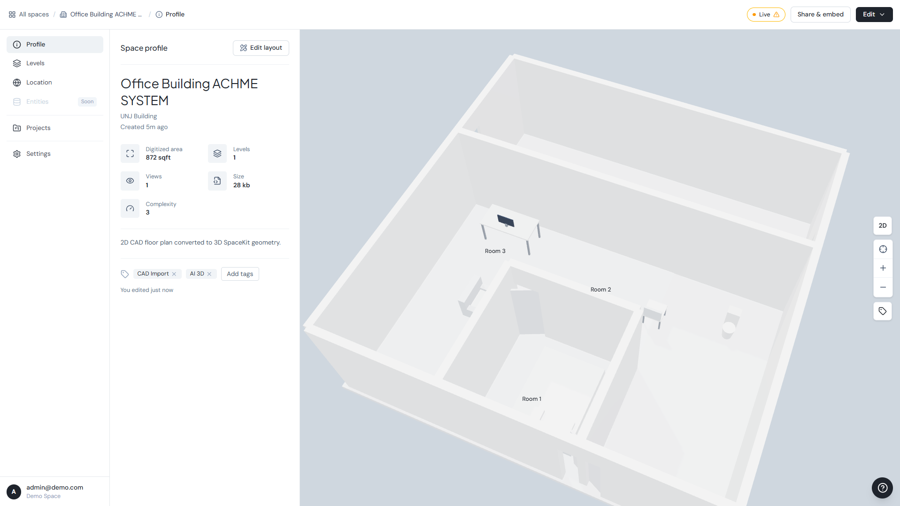
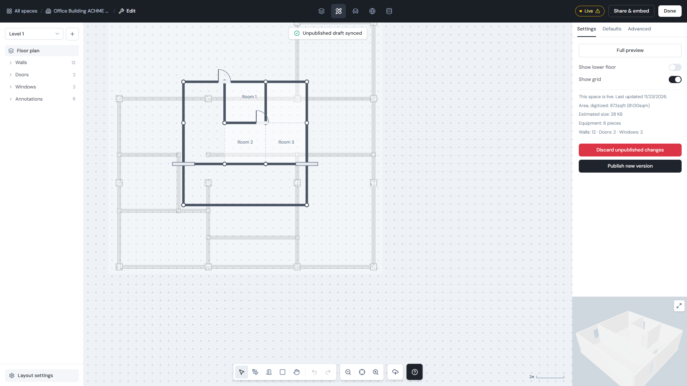
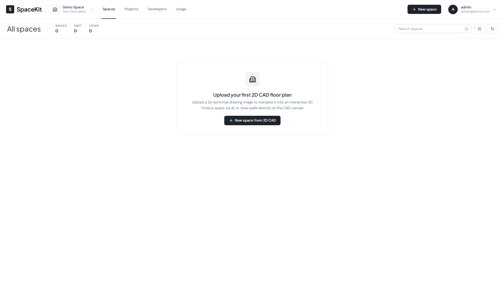
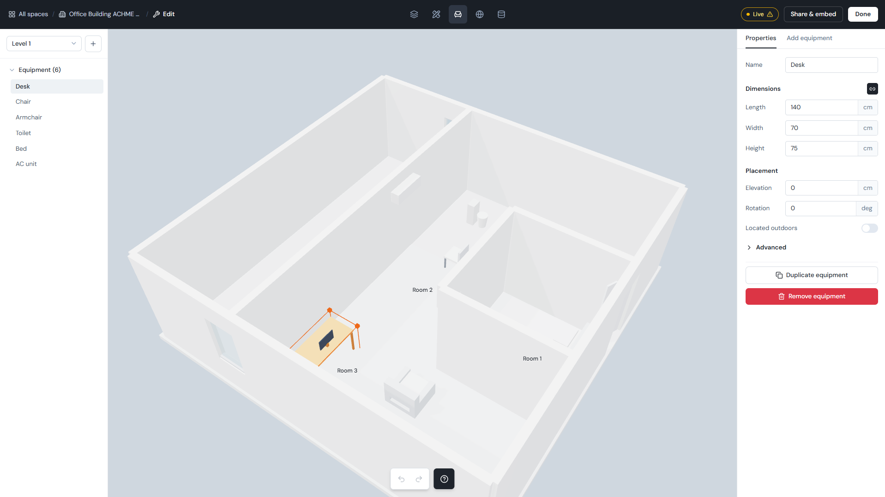
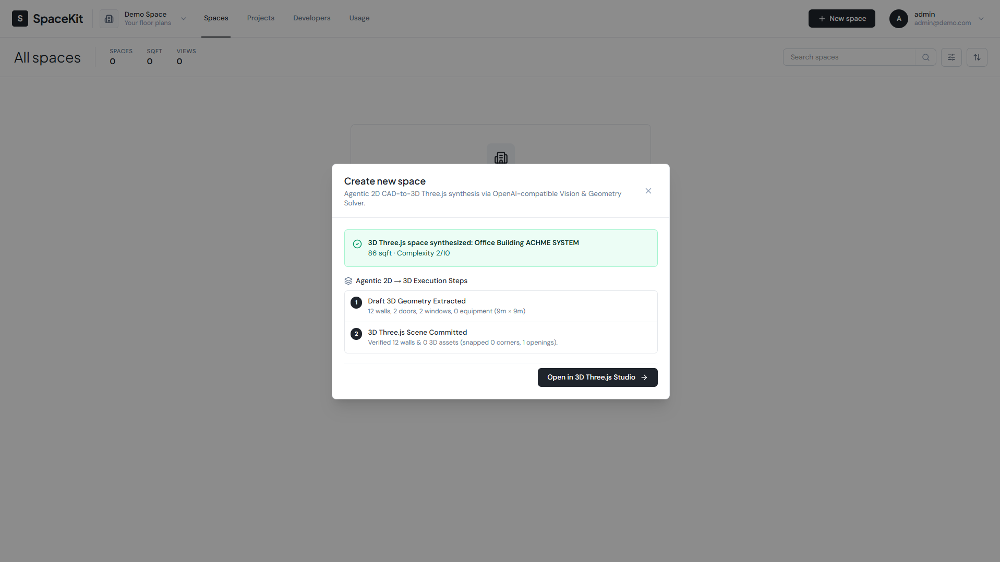
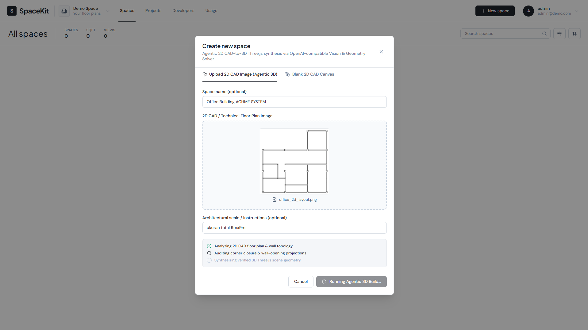
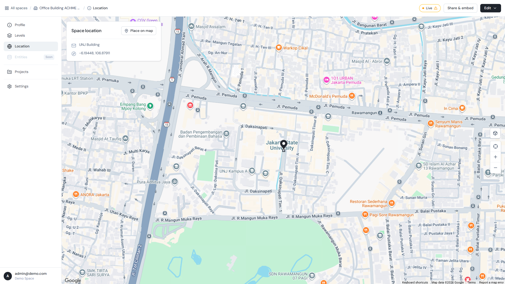
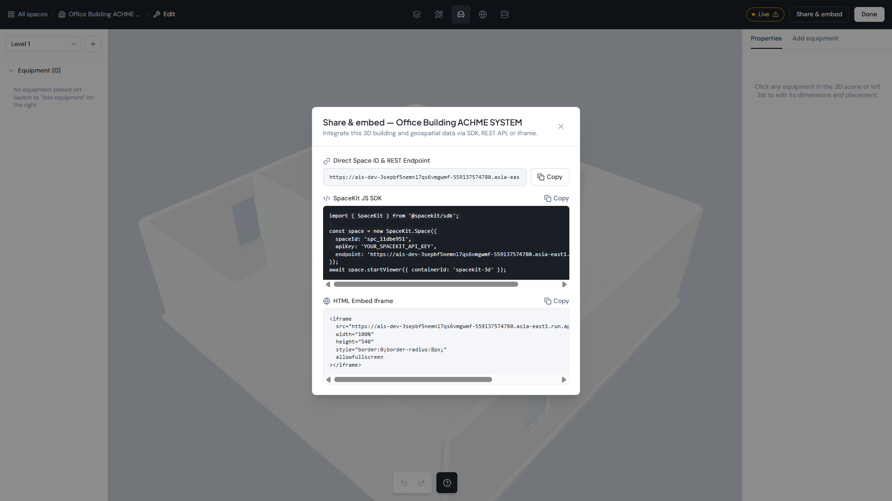
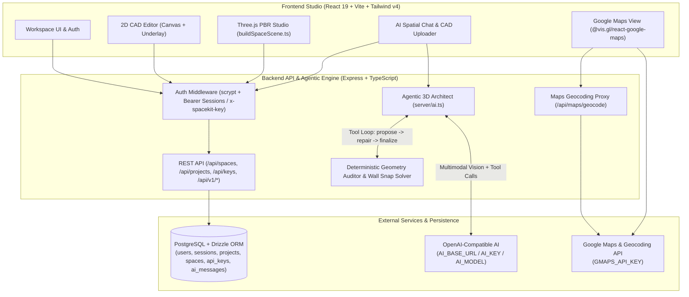

<div align="center">

# SpaceKit

**Agentic 2D CAD-to-3D Three.js Spatial Studio, Geospatial Mapping & Developer SDK Platform**

[](https://www.typescriptlang.org/)
[](https://react.dev/)
[](https://threejs.org/)
[](https://expressjs.com/)
[](https://orm.drizzle.team/)
[](https://developers.google.com/maps)
[](#apps-system-architecture)
[](https://tailwindcss.com/)

Transform 2D technical floor plans into interactive Three.js 3D buildings through an agentic AI vision & geometry solver, anchor footprints onto Google Maps, and serve live spatial + GeoJSON APIs via developer keys.

</div>

---

## Visual Showcase

### 3D Spatial Profile & Interactive Studio


### 2D CAD Floor Plan Editor with Underlay & Live 3D Preview


### Platform Capabilities Grid

<table>
  <tr>
    <td width="33.33%" valign="top">
      
      <br />
      <sub><strong>1. Spaces Workspace</strong> — Clean onboarding & multi-space spatial catalog.</sub>
    </td>
    <td width="33.33%" valign="top">
      
      <br />
      <sub><strong>2. 2D CAD Upload & Agentic Run</strong> — Upload technical drawings with scale hints.</sub>
    </td>
    <td width="33.33%" valign="top">
      
      <br />
      <sub><strong>3. Agentic 3D Verification</strong> — Multi-step wall audit, corner snapping & synthesis.</sub>
    </td>
  </tr>
  <tr>
    <td width="33.33%" valign="top">
      
      <br />
      <sub><strong>4. 3D Equipment Studio</strong> — Interactive Three.js selection, dimensions & rotation.</sub>
    </td>
    <td width="33.33%" valign="top">
      
      <br />
      <sub><strong>5. Geospatial Placement</strong> — Google Maps pin, geocoding & footprint alignment.</sub>
    </td>
    <td width="33.33%" valign="top">
      
      <br />
      <sub><strong>6. Developer SDK & Embed</strong> — Ready-to-use JS SDK, REST endpoints & iframe embed.</sub>
    </td>
  </tr>
</table>

---

## Project Structure

```text
SpaceKit/
├── .env.example                 # Environment variable template (DB, Google Maps, OpenAI-compatible AI)
├── .gitignore                   # Excludes node_modules, dist, .env*, and public/assets/aistudio/
├── drizzle.config.ts            # Drizzle Kit configuration using split PG* credentials
├── index.html                   # SPA entry HTML & Google Fonts (Plus Jakarta Sans, DM Sans, JetBrains Mono)
├── package.json                 # Dependencies and build/dev/lint scripts
├── server.ts                    # Express API server, Vite middleware, v1 SDK/GeoJSON & AI routes
├── tsconfig.json                # TypeScript compiler configuration
├── vite.config.ts               # Vite + Tailwind CSS v4 configuration
├── docs/                        # Documentation & showcase screenshots referenced by README.md
│   ├── screen_space_main1.png
│   ├── screen_space_main2.png
│   └── screen_space_{2,4,5,6,7,8}.png
├── server/
│   ├── ai.ts                    # Agentic 2D->3D pipeline (OpenAI-compatible tools + geometry solver + Gemini fallback)
│   ├── auth.ts                  # scrypt password hashing, timingSafeEqual & Bearer DB sessions
│   └── db.ts                    # PostgreSQL connection pool (PGHOST/PGPORT/PGDATABASE/PGUSER/PGPASSWORD) & schema bootstrap
└── src/
    ├── App.tsx                  # Main workspace shell, navigation, auth state & editor routing
    ├── index.css                # Tailwind v4 styles & typography tokens
    ├── main.tsx                 # React 19 root mount
    ├── db/
    │   └── schema.ts            # Drizzle ORM tables: users, sessions, projects, spaces, api_keys, ai_messages
    ├── lib/
    │   └── api.ts               # Typed frontend API client (in-memory Bearer session auth)
    ├── three/
    │   └── buildSpaceScene.ts   # Procedural Three.js PBR builder (walls with cutouts, glazing, doors, 15 asset kinds)
    ├── types/
    │   └── space.ts             # Shared SpaceData, Geo, API Key, Auth & AgentStepTrace types
    └── components/
        ├── AiSpatialChat.tsx    # Multimodal AI Spatial Architect drawer with design mutation traces
        ├── AuthScreen.tsx       # Workspace sign-in & account registration view
        ├── CadEditor2D.tsx      # 2D vector CAD floor plan editor with underlay & live 3D mini-preview
        ├── CadUploadModal.tsx   # 2D CAD upload modal & blank space creator with live agentic progress
        ├── DevelopersView.tsx   # API key lifecycle manager & live REST/GeoJSON SDK playground
        ├── EquipmentEditor.tsx  # 3D equipment placement, drag-to-move & dimension inspector
        ├── ProjectsAndUsageViews.tsx # Project grouping & workspace usage analytics
        ├── ShareEmbedModal.tsx  # Shareable Space ID, JS SDK snippet & iframe generator
        ├── Space3DViewer.tsx    # Three.js OrbitControls studio renderer with 2D/3D transition & room labels
        ├── SpaceMapView.tsx     # Google Maps 2D/3D geospatial placement wizard & footprint polygon overlay
        └── SpaceThumbnail.tsx   # Crisp miniature 3D/2D floor plan card preview
```

---

## App System Architecture



### Key Architectural Highlights
- **Agentic 2D-to-3D Three.js Pipeline**: When a user uploads a 2D technical drawing or sends a spatial prompt, the backend executes an agentic tool-calling loop (`propose_space_draft` → `repair_and_snap_geometry` → `finalize_3d_space`). A deterministic geometry solver audits wall connectivity, snaps corner endpoints within `0.26m`, and projects doors/windows onto wall segments so `buildWallWithOpenings()` carves clean Three.js cutouts.
- **Draft vs. Live Versioning**: Edits from the 2D CAD canvas, 3D Equipment studio, or AI Chat write safely to `unpublished_data` until explicitly published (`POST /api/spaces/:id/publish`) or discarded.
- **Geospatial & Developer API Layer**: Spaces store WGS84 coordinates, rotation, and scale, exposing `GET /api/v1/spaces/:id` and `GET /api/v1/spaces/:id/geo` (RFC 7946 `FeatureCollection` GeoJSON) authenticated via `x-spacekit-key`.

---

## Tech Stack

| Layer | Technology |
| :--- | :--- |
| **Frontend** | React 19, TypeScript, Vite 8, Tailwind CSS v4, Lucide Icons, Motion |
| **3D Engine** | Three.js (`RoomEnvironment`, `ACESFilmicToneMapping`, `OrbitControls`, procedural PBR geometry) |
| **Geospatial Mapping** | `@vis.gl/react-google-maps` (`APIProvider`, `Map`, `AdvancedMarker`, `Pin`, `Polygon`) + Google Geocoding API |
| **Backend** | Node.js, Express 4, Multer (in-memory CAD image ingestion), `tsx` |
| **Database & Auth** | PostgreSQL (`pg`), Drizzle ORM, `crypto.scrypt` + `timingSafeEqual` + DB-backed Bearer sessions |
| **AI Service** | OpenAI-compatible `/chat/completions` (`AI_BASE_URL`, `AI_KEY`, `AI_MODEL`) + `@google/genai` fallback |

---

## How to Build

### 1. Prerequisites
- **Node.js** `>= 20` (recommended `v22+`)
- **PostgreSQL** instance (e.g., Supabase Pooler, Neon, or local Postgres)
- **Google Maps Platform API Key** (Maps JavaScript API + Geocoding API enabled)
- **OpenAI-Compatible AI Endpoint & Key** (supports vision + JSON/tool calling, e.g., OpenAI, OpenRouter, LiteLLM, vLLM)

### 2. Install Dependencies
```bash
npm install
```

### 3. Configure Environment Variables
Copy `.env.example` to `.env` and fill in your credentials:
```bash
cp .env.example .env
```

```env
APP_URL="http://localhost:3000"

# Split PostgreSQL connection (no DATABASE_URL required)
PGHOST=your-postgres-host
PGPORT=5432
PGDATABASE=postgres
PGUSER=your-postgres-user
PGPASSWORD=your-postgres-password

# Google Maps Platform
GMAPS_API_KEY="your-google-maps-api-key"

# OpenAI-Compatible AI for Agentic 2D -> 3D & Spatial Chat
AI_BASE_URL=https://api.openai.com/v1
AI_KEY=your-openai-compatible-api-key
AI_MODEL=gpt-4o

# Optional fallback Gemini key
GEMINI_API_KEY=""
```

### 4. Verify & Build
```bash
# Type-check codebase
npm run lint

# Build production Vite bundle into dist/
npm run build
```

### 5. Run Locally (Development)
```bash
npm run dev
```
The full-stack Express + Vite app will listen on **http://localhost:3000**. Database tables (`users`, `sessions`, `projects`, `spaces`, `api_keys`, `ai_messages`) are automatically provisioned on startup if they do not exist, or you can push schema migrations via `npx drizzle-kit push`.

---

## How to Deploy

SpaceKit runs as a single Node.js service on port `3000` (or `process.env.PORT`) serving both the `/api/*` backend routes and the static `dist/` frontend bundle when `NODE_ENV=production`.

### 1. Build for Production
```bash
npm ci
npm run build
```

### 2. Start Production Server
> Note: Ensure `tsx` or Node `--experimental-strip-types` is available when running `server.ts`.
```bash
NODE_ENV=production PORT=3000 npx tsx server.ts
```

### 3. Cloud Deployment Checklist (Cloud Run / Railway / Render / Fly.io / VPS)
1. **Set Runtime Secrets** in your hosting provider (never commit `.env`):
   - `PGHOST`, `PGPORT`, `PGDATABASE`, `PGUSER`, `PGPASSWORD`
   - `GMAPS_API_KEY` (restrict HTTP referrers in Google Cloud Console for your production domain)
   - `AI_BASE_URL`, `AI_KEY`, `AI_MODEL`
   - `APP_URL` (your deployed HTTPS URL, used in Share & Embed SDK snippets)
   - `NODE_ENV=production`
2. **Build Command**: `npm install && npm run build`
3. **Start Command**: `npx tsx server.ts`
4. **Health Check Endpoint**: `GET /api/health` → returns `{"ok":true,"dbConfigured":true,"dbConnected":true}`.
